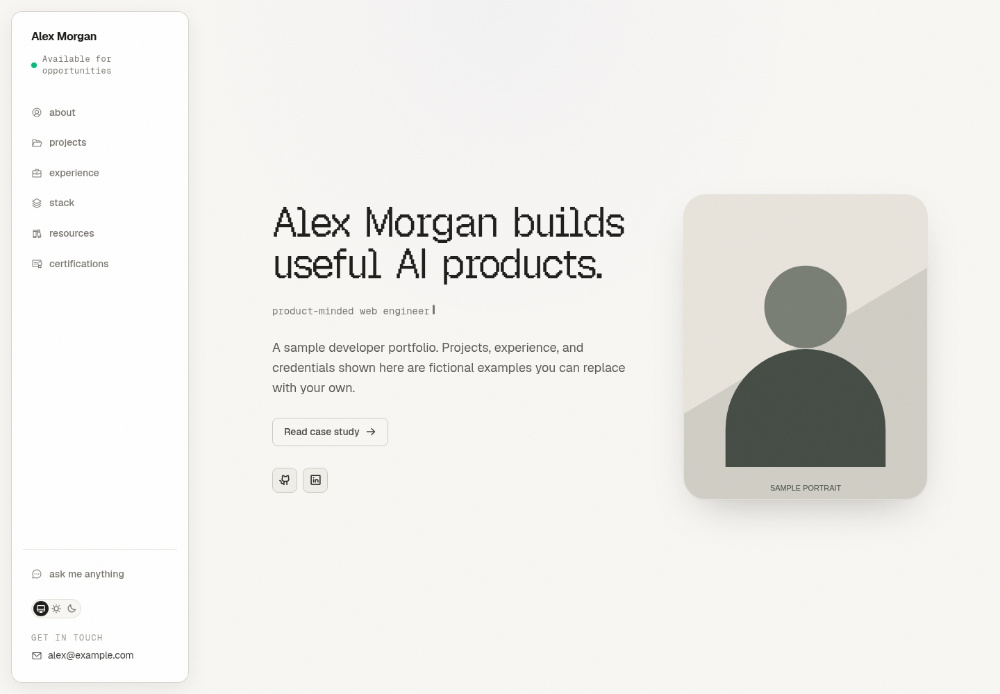
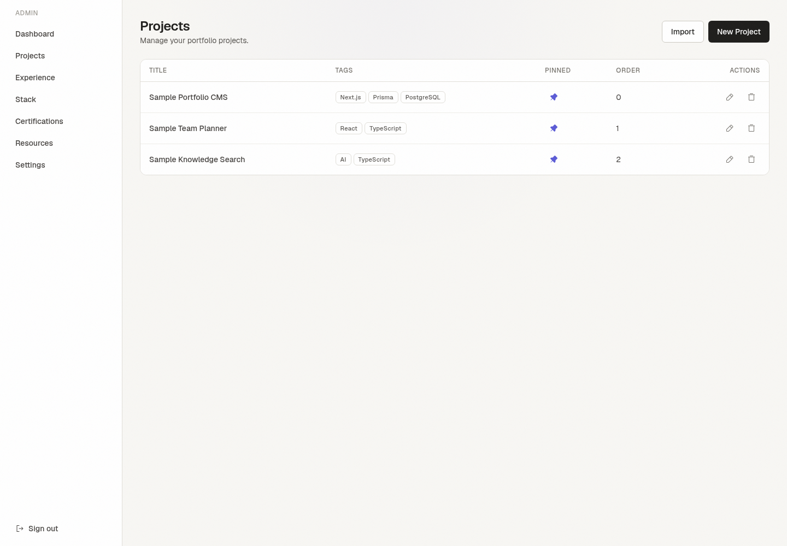

# Portfolio CMS

A developer portfolio you can update through its own admin dashboard. Built with Next.js 16, React 19, TypeScript, Prisma 7, PostgreSQL, and Tailwind CSS 4.

Created by [Ray Arthur Ubaldo](https://github.com/rayubaldo44). [Live personalized portfolio](https://rayubaldo.dev) · [MIT license](LICENSE)

**This public edition uses a fictional developer, Alex Morgan. All sample projects, experience, and credentials are illustrative, not claims about the author.** The live portfolio contains personalized content and may differ from this edition.




## What it includes

- Responsive public pages for projects, experience, skills, certifications, and learning resources.
- A single-owner admin dashboard with validated CRUD forms, project JSON import, screenshot galleries, and certificate uploads.
- Section visibility and availability controls, dark/light themes, keyboard navigation, and reduced-motion support.
- Optional Gemini chat grounded in current public CMS content, GitHub contributions, and Spotify now-playing.
- Canonical metadata, generated social preview, sitemap, robots rules, signed admin sessions, and request rate limits.

The chat reads CMS content into its prompt on each request; this project does not implement a vector database or retrieval pipeline. No paid integrations are required to run the core portfolio.

## Run locally

You need **Node.js 22.15 or newer within Node 22**, npm, and PostgreSQL. PostgreSQL 17 is used in CI. The build downloads Google Fonts, so it needs internet access. Docker is optional; any PostgreSQL instance you control works.

```bash
git clone https://github.com/rayubaldo44/portfolio-cms.git
cd portfolio-cms
cp .env.example .env.local
```

Edit `.env.local` **before installing**: Prisma's install hook reads `DIRECT_URL`. Set both database URLs to your local database, choose an admin password, and generate a separate session secret:

```bash
openssl rand -hex 24  # use as ADMIN_PASSWORD
openssl rand -hex 32  # use as ADMIN_SESSION_SECRET
```

For an isolated local database, this optional Docker command matches the sample URLs. Its credentials are for local development only:

```bash
docker run --name portfolio-cms-db --rm -d \
  -e POSTGRES_USER=portfolio \
  -e POSTGRES_PASSWORD=portfolio_local_only \
  -e POSTGRES_DB=portfolio \
  -p 127.0.0.1:5432:5432 postgres:17-alpine
```

Wait until `docker exec portfolio-cms-db pg_isready -U portfolio -d portfolio` succeeds. If port 5432 is in use, choose another host port and update **both** URLs. This container has no persistent volume: stopping it removes its sample data.

```bash
npm ci
npm run db:push
npm run db:seed
npm run dev
```

Open [localhost:3000](http://localhost:3000), then `/admin-login` and sign in using your configured password. Seeding inserts missing examples and preserves existing records and edits; it does not reset the database. Use your own development database, never a production database, for this setup.

Required configuration:

| Variable | Purpose |
| --- | --- |
| `DATABASE_URL` | PostgreSQL runtime connection; use the pooled URL when your host provides one. |
| `DIRECT_URL` | Prisma CLI connection; use the direct URL when your host provides one. Same as `DATABASE_URL` locally. |
| `ADMIN_PASSWORD` | Single-owner login password; generate a unique value. |
| `ADMIN_SESSION_SECRET` | Separate random secret used to sign sessions. |
| `SITE_URL` | Canonical origin; `http://localhost:3000` locally, your own HTTPS domain when deployed. |

## Optional integrations

Leave optional values empty for the initial setup.

| Feature | Configuration and behavior |
| --- | --- |
| AI chat | Set `GEMINI_API_KEY`; optionally set `GEMINI_MODEL` to one of the allowlisted models in `src/app/api/chat/route.ts`. Without a key, the UI shows an unavailable state and the endpoint returns 503. Availability and billing depend on your Google account. |
| GitHub | Set `GITHUB_USERNAME`. With no username the section is omitted without making an account request. `GITHUB_TOKEN` is optional; without it the app attempts public-page scraping. Review token-backed contribution output before enabling it for accounts with private repositories. |
| Spotify | Set client ID, client secret, and the registered redirect URI. While signed in, visit `/api/spotify/authorize`, approve access, and save the returned refresh token as `SPOTIFY_REFRESH_TOKEN`. Keep the callback response private. Without credentials the widget is omitted. |

For local Spotify OAuth, visit the app at `http://127.0.0.1:3000` and register `http://127.0.0.1:3000/api/spotify/callback` with Spotify. Use your own HTTPS callback in production. No service tokens are included in this repository.

## Make it yours

- **CMS content:** edit projects, experience, skills, certifications, resources, availability, and visibility in the dashboard. Existing sample records can be edited or deleted.
- **Biography and contact data:** the dashboard does not currently expose these fields. Run `npx prisma studio` locally and edit the singleton `SiteSettings` record in your own database. Static fallback copy and sidebar/footer links must also be updated.
- **Branding:** name, homepage statement, social links, fallback biography, sidebar email, footer, page titles, and chat greeting also have static example copy under `src/app` and `src/components`. Search for `Alex`, `alex@example.com`, and `localhost:3000`. This edition intentionally keeps the current architecture rather than adding a new configuration system.
- **Assets:** replace the original SVG placeholders in `public/images` with material you own and update image paths and accessible descriptions. There is no bundled résumé or download button; add your own file and link if needed.
- **SEO:** update `src/lib/site.ts`, root/page metadata, and the generated social image. Set `SITE_URL` before building.
- **Privacy:** replace the sample disclosure at `/privacy` with information matching your deployment and services.

Keep the homepage at a maximum of three featured projects with equal-size desktop cards. The stack has exactly four categories: Frontend, Backend, AI & Machine Learning, Dev Tools, in that order, with equal-size desktop cards. See [AGENTS.md](AGENTS.md).

## Architecture and verification

Public Server Components read Prisma models. Client components handle motion, themes, and forms. Server Actions validate mutations with Zod and authenticate each entrypoint. A configured password creates a signed, expiring, HTTP-only session; the CMS is designed for one owner.

```text
Public pages ── Server Components ──────────── PostgreSQL / Prisma
Admin forms ── authenticated Server Actions ──┘
Chat UI ── /api/chat ── public CMS context ── Gemini (optional)
GitHub section / Spotify widget ─────────── external APIs (optional)
```

```bash
npm run lint
npm run typecheck
npm test
npm run build
npm run start
```

`npm test` runs seven focused scripts covering visibility, resources, stack rendering, project forms, gallery validation, certificate validation, mutation authorization, and absent optional credentials. The Node-only checks use small shims for Next.js CSS modules and its server marker. CI also verifies seeding against disposable PostgreSQL and smoke-tests production HTTP routes.

To run the seed integration check yourself, point the environment at a **disposable, empty** database, apply the schema, then run:

```bash
SEED_TEST_DATABASE=disposable node --import tsx scripts/check-seed.ts
```

With the seeded app running, `node --env-file=.env.local scripts/check-http.mjs` verifies public routes, metadata, placeholder assets, admin redirects, and unconfigured chat. See [deployment notes](docs/deployment.md) for hosting and schema rollout, and [release verification](docs/verification.md) for what was actually tested.

## Limits and maintenance

- This is a lean runnable showcase, not a multi-tenant CMS or a fully configurable portfolio product.
- Rate limits are in memory and independent per process. Configure hosting-level controls or shared counters if your deployment needs stronger abuse protection.
- Schema rollout uses `prisma db push`; there is no versioned migration history. Review destructive changes and back up existing databases before rollout.
- GitHub scraping can fail or change and is an approximate fallback. External APIs, model names, and provider quotas can change independently of this app.
- Image and certificate data can be stored in PostgreSQL. Large installations may prefer object storage; the current design targets a small portfolio.
- Seeding is additive. It will recreate a deleted sample record if you run it again; remove sample definitions if you do not want that behavior.
- Automated checks do not certify every integration or browser. Actual Gemini, GitHub-token, and Spotify account flows require your own credentials.

[Contributing](CONTRIBUTING.md) · [Security reporting](SECURITY.md) · [Third-party notices](THIRD_PARTY_NOTICES.md)
